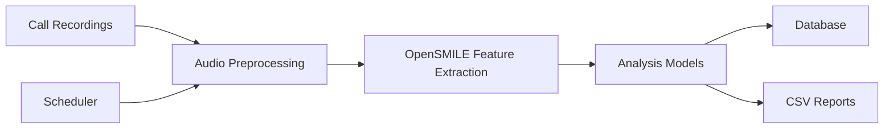

# 🎧 Call Audit & Analysis

**A Python platform for processing, analyzing, and auditing call recordings**

[](https://www.python.org/)
[](https://audeering.github.io/opensmile/)
[](LICENSE)
[](#)

[Overview](#overview) • [Features](#features) • [Architecture](#architecture) • [Getting Started](#getting-started) • [Usage](#usage) • [Contributing](#contributing)

</div>

---

## Overview

**Call Audit & Analysis** is a Python application that processes call recordings and converts them into meaningful audit insights.

It combines OpenSMILE feature extraction, database management, structured reporting, secure credential handling, and automated scheduling into one modular workflow.

---

## Features

- 🎙️ Audio preprocessing and feature extraction
- 📊 OpenSMILE-powered call analysis
- 🗄️ Database initialization and record management
- ⏰ Scheduled and automated processing
- 📁 CSV and structured report generation
- 🔐 Credential and token management
- 📝 Application and scheduler logging
- 🧩 Modular configuration, routes, schemas, and utilities

---

## Architecture



---

## Tech Stack

| Area | Technology |
|---|---|
| Language | Python 3.10+ |
| Audio Analysis | OpenSMILE |
| Database | SQLite or SQL-based database |
| Data Output | CSV |
| Automation | Python task scheduler |
| Credentials | Local credential/token management |

---

## Project Structure

```text
Call-Audit-and-Analyzing/
├── 📄 create_tables.py       # Initialize database tables
├── 📄 main.py                # Application entry point
├── 📄 scheduler.py           # Task automation
├── 📄 scheduler.log          # Scheduler activity
├── 📄 token_manager.py       # Credential and token utilities
├── 📄 requirements.txt       # Python dependencies
├── 🎵 myaudio.wav            # Example recording
├── 📊 opensmile_output.csv   # Extracted audio features
├── 📊 output.csv             # Generated analysis report
│
├── 📁 credentials/           # API keys and secrets
├── 📁 data/                  # Call recordings and processed data
├── 📁 logs/                  # Application logs
└── 📁 src/
    ├── 📁 config/            # Configuration
    ├── 📁 database/          # Database models and scripts
    ├── 📁 models/            # Business and analysis models
    ├── 📁 routes/            # API routes
    ├── 📁 schemas/           # Request and response schemas
    └── 📁 utils/             # Shared utilities
```

---

## Getting Started

### Prerequisites

- Python 3.10 or newer
- `pip`
- Git
- OpenSMILE

### 1. Clone the Repository

```bash
git clone https://github.com/Thunder-Lion18/Call-Audit-and-Analyzing.git
cd Call-Audit-and-Analyzing
```

### 2. Create a Virtual Environment

#### Windows

```powershell
python -m venv venv
venv\Scripts\activate
```

#### macOS or Linux

```bash
python3 -m venv venv
source venv/bin/activate
```

### 3. Install Dependencies

```bash
python -m pip install --upgrade pip
pip install -r requirements.txt
```

### 4. Configure the Application

1. Add required credentials inside `credentials/`.
2. Update settings under `src/config/`.
3. Place call recordings inside `data/`.

> ⚠️ Never commit passwords, API keys, `.env` files, or real call recordings.

### 5. Initialize the Database

```bash
python create_tables.py
```

### 6. Run the Application

```bash
python main.py
```

---

## Usage

```text
1. Place an audio recording in data/
2. Configure credentials and application settings
3. Initialize the database
4. Run main.py
5. Review generated reports and database records
6. Use scheduler.py for automated processing
```

### Generated Outputs

- Extracted audio features
- Call-analysis results
- Structured CSV reports
- Database records
- Application and scheduler logs

---

## Security

- Never commit credentials or secrets
- Keep `.env` and credential files private
- Add sensitive files to `.gitignore`
- Use environment variables in production
- Restrict access to call recordings and analysis reports
- Follow applicable call-recording privacy and consent regulations

---

## Contributing

Contributions are welcome.

```bash
git checkout -b feature/your-feature-name
git commit -m "Add a new feature"
git push origin feature/your-feature-name
```

Then open a pull request for review.

For major changes, please open an issue first to discuss the proposed update.

---

## Reporting Issues

When reporting a bug, include:

- Steps to reproduce
- Expected and actual behavior
- Relevant logs
- Operating system
- Python version
- Screenshots, if applicable

---

## License

This project is licensed under the [MIT License](LICENSE).

<div align="center">

⭐ If you find this project useful, consider giving it a star!

</div>
